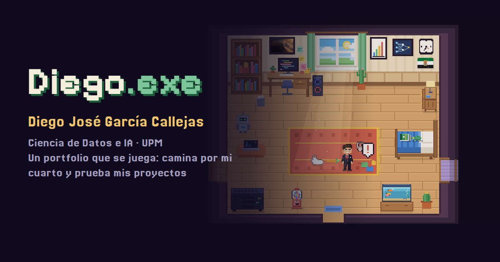

# Diego.exe — a portfolio you can play



**▶ Play it: [diegojgarciacallejas.github.io](https://diegojgarciacallejas.github.io/)**

My personal portfolio as a small pixel-art game. Walk around my room, talk to the people passing by, and every object opens one of my projects: an AI lab you can play with, my résumé, a retro desktop with a Linux-style terminal and a 3D building game. Available in **English and Spanish**, on desktop and mobile.

> 🇪🇸 Mi portfolio convertido en un pequeño juego en pixel art: camina por mi cuarto y cada objeto abre un proyecto (laboratorio de IA, expediente, un escritorio retro con terminal y un juego de construcción en 3D). En español e inglés, en ordenador y en móvil.

## What's inside

| | |
|---|---|
| 🧠 **AI Lab** | A neural network you can train live, a CNN that recognises the digits you draw (trained with PyTorch, run here from scratch in JavaScript), A* vs Dijkstra vs greedy path finding, and K-Means with the elbow method |
| 🖥️ **DiegOS** | A retro desktop with draggable windows, a Linux-style terminal (`ls`, `cd`, `cat`, `open`, `neofetch`…), files, a calculator and settings |
| 🧱 **Blocks 3D** | Rebuild 15 models brick by brick in 3D (the only 3D part, made with Three.js) |
| 📄 **Résumé** | My CV in English and Spanish, with PDF download |
| ⚽ **And more** | A yard with a penalty shoot-out, a swing and neighbours to chat with, the live Madrid weather, day and night by Madrid time, chiptune music, 24 achievements and 5 hidden items |

## How it's made

Plain HTML, CSS and JavaScript — no frameworks, no build step. The game runs on [Phaser 3](https://phaser.io/); the 3D game uses [Three.js](https://threejs.org/). The pixel art, the neural networks, the search algorithms, the sound and the music are all written by hand, and every page works without external requests (except the weather API).

## Run it locally

```bash
python -m http.server 8000
```

Then open <http://localhost:8000> (opening `index.html` directly does not work).

## Project structure

```
index.html        the game          js/          game code (config.js holds texts and settings; cars.js the street's vehicles)
lab/              AI lab            os/          DiegOS
juegos/piezas/    3D blocks game    cv/          résumé page and PDFs
fonts/  img/  lib/                  fonts, images and third-party libraries
```

New text for the game goes in `js/config.js` (Spanish) and its English version in `js/lang-en.js`.

## Credits and licences

- Code, pixel art and texts: © Diego José García Callejas
- [Phaser 3.80](https://phaser.io/) and [Three.js](https://threejs.org/): MIT licence (`lib/phaser.LICENSE`, `lib/three.LICENSE`)
- Fonts Pixelify Sans, Jersey 20, Hanken Grotesk and VT323: SIL Open Font License (`fonts/LICENSE-*`)
- Live weather: [Open-Meteo](https://open-meteo.com/)

**Contact:** [LinkedIn](https://www.linkedin.com/in/diegojosegarciacallejas) · [GitHub](https://github.com/diegojgarciacallejas)
